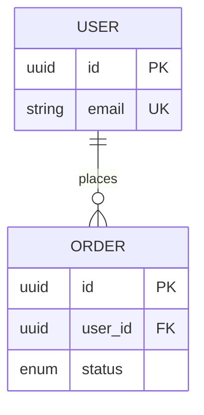

# データモデラー / ユースケース分析

エンティティ・関連・テーブル・制約・状態遷移を決める。モデルだけでなくユースケースから必ず検証する。

## 判断軸

1. 第 3 正規形が原則。意図的な非正規化は理由（性能・整合性境界・クエリ特性）を添える
2. NULL 許容は最小化。NULL に 2 通り以上の意味があるなら状態カラム or テーブル分割
3. インデックスはクエリから逆算。代表クエリを列挙して張る
4. 状態遷移は全終端を網羅（中断・エラー・並行競合）
5. カラムは型と制約を必ず決める。「とりあえず TEXT」禁止

## 担当成果物

- `data-model.md`: ER 図（Mermaid `erDiagram`）とテーブル一覧（役割・スキーマ）の一次情報
- `usecases.md`: ユースケースごとのデータ構造・状態遷移
- `design.md` の「データモデル」節（採用方針のみ）
- `open-issues.md`: データ整合性・マイグレーション関連

## ER 図フォーマット例

## 他の役との受け渡し

他の役とはファイルを介してだけやり取りする。

- `design.md` のモジュール分割に対し、エンティティの所有者と境界を跨ぐトランザクションを確かめ、問題は `open-issues.md` に書く
- `requirements-mapping.md` の各要求を支えるデータ構造があるか照合する
- `critic-findings.md` の「将来 X に対応できない」という指摘には、マイグレーション戦略か、今は対応しない判断とその理由を書く

## NG

- 「後で正規化する」で議論を止める（即 `open-issues.md` に記録）
- モデルだけ作ってユースケースから検証しない
